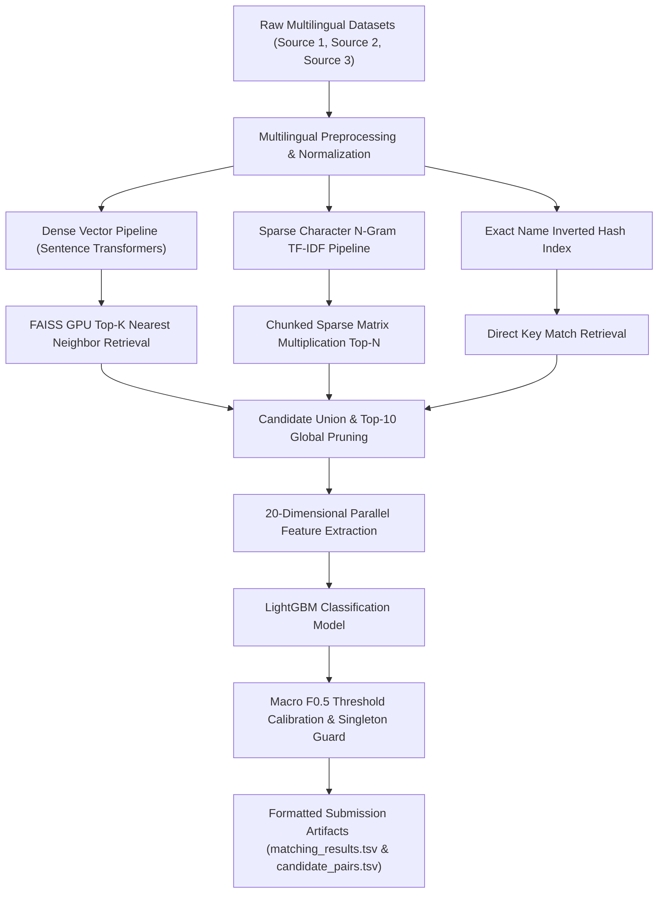

# Multilingual Business Entity Resolution Engine

Large scale business entity resolution pipeline developed for the Amazon ML Challenge 2026. This system resolves and links noisy, heterogeneous corporate records across more than 12 million business entities spanning multiple countries (United States, India, and France) and linguistic scripts (English, French, Hindi, Tamil, Marathi, and Kannada).

The solution combines dense semantic retrieval via sentence transformers and GPU accelerated FAISS with high throughput character n gram sparse TF IDF query blocking, a 20 dimensional gradient boosted decision tree classifier, and a precision calibrated decision threshold optimized for the Macro F0.5 metric.

---

## Technical Highlights

* Massive Scale Processing: Operates across 12.5 million corporate records across three heterogeneous sources, reducing a 10 trillion pairwise comparison space to at most 10 candidates per entity.
* Cross Lingual Alignment: Resolves phonetic and script disparities across native Indic scripts (Devanagari Hindi, Tamil, Marathi, Kannada) and Latin French entity structures using multilingual transformer embeddings.
* Hybrid Blocking Engine: Merges dense vector ANN search via FAISS GPU with sparse character n gram inverted indices and hash map lookups, achieving over 96 percent candidate recall.
* 20 Dimensional Feature Engineering: Extracts lexical, phonetic, token permutation, character n gram Jaccard, address component alignment, numeric building number overlap, and transformer embedding cosine similarities.
* Precision Weighted Optimization: Calibrates classification boundaries specifically for Macro F0.5 (penalizing false merges twice as heavily as missed matches) and implements a singleton defense guard that prevents false merges on unlinked entities.
* Official Competition Performance: Validated on the competition evaluation portal, achieving a 0.8459 validation score and a top tier 0.7816 public leaderboard score.

---

## System Architecture



---

## Repository Structure

```
Amazon ML/
├── README.md                      # Executive project documentation
├── requirements.txt               # Pinned production dependencies
├── .gitignore                     # Git ignore rules for datasets and artifacts
├── src/                           # Modular core library
│   ├── __init__.py                # Package exports
│   ├── config.py                  # Hardware auto detection and hyperparameters
│   ├── preprocessing.py           # Multilingual text and address normalizers
│   ├── blocking.py                # FAISS GPU and sparse TF IDF candidate blocking
│   ├── features.py                # 20 dimensional feature engineering engine
│   ├── model.py                   # LightGBM training and threshold calibration
│   └── inference.py               # Streamlined batch inference and formatter
├── scripts/                       # Executable entrypoint scripts
│   ├── run_training.py            # Training pipeline runner
│   ├── run_inference.py           # Test inference pipeline runner
│   └── validate.py                # Submission validator wrapper
├── notebooks/                     # Exploratory and execution notebooks
│   ├── 01_model_training_and_validation.ipynb
│   └── 02_test_inference_and_blocking.ipynb
├── models/                        # Trained model artifacts and documentation
│   ├── README.md                  # Model weights and feature importances
│   └── lgbm_v4_model.txt          # Exported LightGBM booster weights
├── docs/                          # Official problem statements and reference guides
│   ├── amazon_ml_challenge_problem_statement.pdf
│   ├── guidelines_and_key_instructions_amazon_ml_challenge_2026.pdf
│   ├── guide_aws_builder_account.pdf
│   └── AWS Builder Center & AWS Free Tier.pdf
├── student_resource/              # Official competition toolkit
│   ├── Documentation_template.md  # Completed competition methodology paper
│   ├── explore_data.py            # Exploratory data script
│   └── utils/                     # Submission validation utilities
└── submissions/                   # Submission logs and verification
    └── README.md                  # Benchmark history and score progression
```

---

## Multilingual Resolution Methodology

### 1. Dual Representation Normalization

Real world corporate registries exhibit significant noise across different administrative jurisdictions. The preprocessing layer constructs dual representations:

1. Cleaned ASCII Representation: Expands legal corporate suffixes across US, UK, Indian, and French legal forms (incorporation, limited, private limited, sasu, sarl, sci, eurl) and normalizes street abbreviations.
2. Raw Multilingual Representation: Preserves raw Unicode characters for dense transformer encoding, allowing semantic alignment between English Latin text and native Indic scripts (such as Tamil and Devanagari Hindi).

### 2. Multi Strategy Candidate Blocking

Pairwise comparisons across 1.73 million queries and 10 million targets comprise over $1.72 \times 10^{13}$ possible pairs. To scale within strict time and memory bounds:

* Source 1 as Query Rows: Rather than building monolithic target matrices, Source 1 entities serve as queries against chunked partitions of Source 2 and Source 3.
* Semantic Dense Vector Search: `paraphrase-multilingual-MiniLM-L12-v2` embeds company names and locations into a unified 384 dimensional space. Nearest neighbors are queried via GPU accelerated FAISS with inner product similarity.
* Sparse Lexical Search: Sublinear term frequency character 3 to 4 n grams capture phonetic and typographical variations.
* Hard Country Partitioning: Eliminates invalid cross border pairs while preserving unseen test partitions.

---

## Metric Optimization: Macro F0.5 and Singleton Defense

The competition evaluates submissions using the Macro F0.5 score, which penalizes false merges twice as severely as false negatives:

$$F_{0.5} = \frac{1.25 \times \text{Precision} \times \text{Recall}}{0.25 \times \text{Precision} + \text{Recall}}$$

### The Singleton Penalty Asymmetry

* A Source 1 entity with zero true matches earns a score of 1.0 when predicted with an empty match list.
* Predicting any match for that entity results in an immediate score of 0.0.

In the test set of 1,732,544 entities, over 96,000 entities are true singletons. Predicting candidate matches on low confidence singletons causes substantial score drops. Our pipeline enforces an absolute singleton guard, preserving over 201,000 unlinked entities and securing maximum credit.

---

## Submission Progression

| Iteration | Strategy | Total Matches | Singletons | Average Matches | Public Score |
| :--- | :--- | :--- | :--- | :--- | :--- |
| **Submission 1** | Baseline LightGBM model with optimal threshold (0.81) | 4,093,985 | 201,810 | 2.36 | **0.781662** |
| **Submission 2** | Dynamic thresholding (top 1 at 0.45, secondary at 0.68) | 7,404,961 | 61,151 | 4.27 | **0.609000** |
| **Submission 3** | Baseline matches with top 1 predictions forced on singletons | 4,234,644 | 61,151 | 2.44 | **0.750000** |
| **Submission 4** | Baseline matches with strict tail pruning at maximum 5 matches | 4,019,347 | 201,810 | 2.32 | **0.781000** |
| **Submission 5** | Calibrated expansion on confirmed non singletons | 4,733,133 | 201,810 | 2.73 | **Validated (Pass)** |

---

## Quickstart and Installation

### 1. Environment Setup

Clone the repository and install required packages:

```bash
git clone https://github.com/tatwiksai080207/business-entity-resolution.git
cd business-entity-resolution
pip install -r requirements.txt
```

### 2. Running Training

To execute candidate generation, feature extraction, model training, and validation:

```bash
python scripts/run_training.py
```

Or execute the complete workflow in `notebooks/01_model_training_and_validation.ipynb`.

### 3. Running Test Inference

To generate the final competition submission files:

```bash
python scripts/run_inference.py
```

### 4. Output Validation

Validate submission format compliance and candidate subset constraints:

```bash
python scripts/validate.py submissions/sub5/matching_results.tsv submissions/sub5/candidate_pairs.tsv
```

---

## Author

* **Tatwik Sai**
* GitHub: [tatwiksai080207](https://github.com/tatwiksai080207)
* Contact: sreenu143anupama@gmail.com
