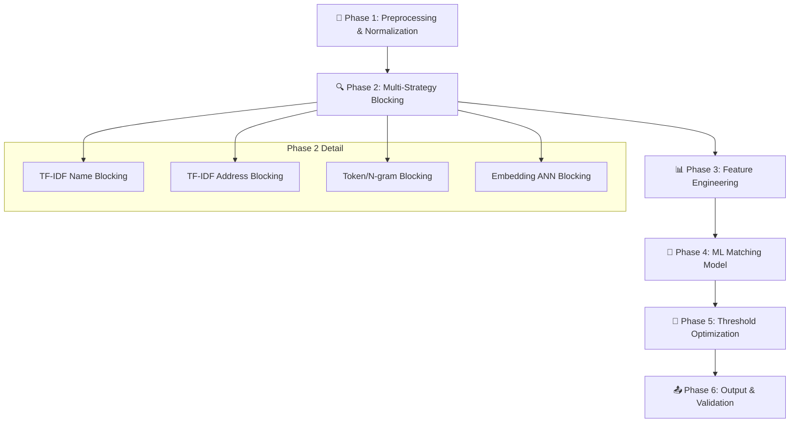

# 🏆 Amazon ML Challenge 2026 — Master Battle Plan
## Business Entity Resolution | Maximize F₀.₅ Score

---

## 1. Problem Summary & Key Insights

### What We're Solving
Given business records from **3 sources**, determine which records across Source 2 and Source 3 match each Source 1 entity. Source 1 is the deduplicated reference.

### Dataset Scale

| Dataset | Source 1 | Source 2 | Source 3 |
|---------|----------|----------|----------|
| **Train** | 2,206,821 | 5,034,616 | 5,285,603 |
| **Test** | 1,732,544 | 4,887,273 | 5,082,316 |

### Critical Data Characteristics

| Insight | Detail | Impact on Strategy |
|---------|--------|--------------------|
| **Countries** | Train: US + India. Test: US + India + **France** (unseen!) | Must NOT hard-code countries; need language-agnostic features |
| **Singletons** | 5.6% of S1 entities have NO matches | Predicting empty = free 1.0 score per entity. ~95K singletons in test! |
| **Match Count** | Avg 3.67 matches per non-singleton, max 11 | Need high-recall blocking to catch all matches |
| **Distribution** | Most common: 3 matches (531K), then 4 (484K) | Typical entity has 2-4 S2/S3 matches |
| **Name Noise** | Transliteration (Hindi→Devanagari, Tamil→Tamil script), typos, abbreviations, legal suffix variations | Need robust text normalization + embedding-based matching |
| **Address Noise** | Missing components, reordering, abbreviations (St→Street), landmark references, NULL addresses (~3% missing in S2/S3) | Address matching must handle partial/missing data gracefully |
| **S2 vs S3** | Matched S2: 3.69M, Matched S3: 3.94M (roughly even) | Treat S2 and S3 identically in pipeline |

### Scoring: F₀.₅ (Precision-Heavy)

```
F₀.₅ = (1.25 × Precision × Recall) / (0.25 × Precision + Recall)
```

> [!IMPORTANT]
> **Precision matters 2× more than recall.** A false merge (predicting a wrong match) is far more damaging than a missed match. This means:
> - **Set thresholds conservatively** — only match when highly confident
> - **Singletons are free points** — correctly predicting "no match" = 1.0 score
> - **Each false positive on a singleton = 0.0** — devastating

---

## 2. Hardware Assessment

### Local Machine
- **CPU**: Standard (unknown cores)
- **GPU**: NVIDIA RTX 3050 Laptop (4GB VRAM) — too small for large models
- **RAM**: 16GB — **CRITICAL BOTTLENECK** — datasets alone are ~1.3GB per source file
- **Disk**: Sufficient

### AWS (Available)
- GPU instances available — **need to determine type**

> [!IMPORTANT]
> **Action Required from You:** Run this command on your AWS instance to check GPU type:
> ```bash
> nvidia-smi
> ```
> Also run:
> ```bash
> free -h  # Check RAM
> df -h    # Check disk space
> ```
> Tell me the output so I can calibrate the pipeline's memory usage and batch sizes.

---

## 3. Architecture Overview



---

## 4. Detailed Phase Breakdown

### Phase 1: Preprocessing & Normalization (Hours 0–3)

This phase is **make-or-break** — if names/addresses aren't normalized well, blocking will miss true matches.

#### 1.1 Text Cleaning
```
- Lowercase everything
- Normalize unicode (NFKD → strip accents for matching features, keep originals)
- Remove/normalize punctuation: & → and, . removal from abbreviations
- Collapse multiple whitespace
```

#### 1.2 Business Name Normalization
```
- Legal suffix standardization: 
    Corp/Corporation → corp, LLC/L.L.C. → llc, Ltd/Limited → ltd,
    Pvt/Private → pvt, Inc/Incorporated → inc, 
    LLP → llp, SASU/SAS/SARL/EURL/SCI/SA (French) → keep as-is
- Remove common noise prefixes: "-- " (seen in S2 data)
- Handle transliteration: Hindi/Tamil script → romanized equivalents
    This is KEY for Indian entities — S2 has Hindi script names matching English S1 names
```

> [!WARNING]
> **Transliteration is a major challenge.** Indian S2 records use Devanagari (Hindi), Tamil script etc. for the same business names. We need:
> - `indic-transliteration` or `ai4bharat-transliteration` library
> - OR embed both scripts into a shared vector space using multilingual models (better approach)

#### 1.3 Address Normalization
```
- Abbreviation expansion: St→Street, Ave→Avenue, Rd→Road, Blvd→Boulevard, Dr→Drive, Ct→Court
- Remove "null", "nan", "N/A" strings
- Extract structured components where possible: PIN/ZIP code, state, city
- For India: Extract PIN code (6-digit), state name
- For US: Extract ZIP (5-digit), state abbreviation  
- For France: Extract postal code (5-digit), department/region
```

#### 1.4 Country-Based Partitioning
```
- Process each country separately to avoid cross-country false matches
- S1 country → only compare against S2/S3 with same country
- This immediately reduces comparison space by ~60%
```

### Phase 2: Multi-Strategy Blocking (Hours 3–8)

> [!IMPORTANT]
> **Blocking is the CEILING of your recall.** If a true match isn't in your candidate set, your model can never find it. We need **high recall** blocking (target: 98%+ recall of true matches).

#### Strategy: Union of Multiple Blocking Methods

We run **4 parallel blocking strategies** and take the **union** of all candidate pairs. This maximizes recall at the cost of more candidates (which the ML model will filter).

#### 2.1 TF-IDF Cosine Blocking on Business Name (Primary)
```python
# For each country partition:
# 1. Build TF-IDF (char n-grams, n=2-4) on S1 names
# 2. Transform S2/S3 names with same vectorizer
# 3. Compute sparse cosine similarity
# 4. For each S2/S3 record, find top-K (K=20-50) most similar S1 records
# 5. Keep pairs with cosine > 0.3 (low threshold for high recall)

# This handles:
# - Typos (char n-grams are robust)
# - Abbreviations (shared character patterns)
# - Word reordering (bag-of-ngrams is order-invariant)
```

**Implementation:** Use `sklearn.feature_extraction.text.TfidfVectorizer` with `analyzer='char_wb'`, `ngram_range=(2,4)`. Use `sparse_dot_topn` library for efficient top-K sparse matrix multiplication.

#### 2.2 TF-IDF Cosine Blocking on Business Address
```python
# Same as 2.1 but on address field
# Lower threshold (0.2) since addresses are noisier
# This catches cases where names are very different but addresses match closely
```

#### 2.3 Token-Based Blocking (Fast, High Coverage)
```python
# For each S1 entity, generate "blocking keys":
# - First 3 chars of business name + country
# - ZIP/PIN code (if available)
# - Phonetic encoding of first word (Soundex/Metaphone)
# Only compare records sharing at least one blocking key
```

#### 2.4 Sentence Embedding ANN Blocking (Semantic, Handles Transliteration)
```python
# Use multilingual sentence-transformers model:
#   paraphrase-multilingual-MiniLM-L12-v2 (118M params, MIT license)
# 1. Encode "name + address" as embedding for all records
# 2. Build FAISS IVF index on S1 embeddings
# 3. Query with S2/S3 embeddings, retrieve top-K=30 nearest neighbors
# 4. This handles:
#    - Transliteration (Hindi/Tamil → English, shared embedding space)
#    - Semantic equivalence (different words, same meaning)
#    - France (unseen country — multilingual model generalizes)
```

> [!TIP]
> **Why multilingual embeddings are critical:** The Indian data has names in Devanagari/Tamil script in S2/S3 matching English names in S1. A multilingual model maps both to the same vector space. Same for French entities.

#### 2.5 Candidate Set Assembly
```python
# Union all candidates from strategies 2.1–2.4
# Deduplicate pairs
# Expected: ~50-200 candidates per S1 entity
# Target: 98%+ recall of true matches in candidate set
```

### Phase 3: Feature Engineering (Hours 8–14)

For each (S1, S2/S3) candidate pair, compute a rich feature vector:

#### 3.1 Name Features
| Feature | Description | Why |
|---------|-------------|-----|
| `name_jaccard` | Jaccard similarity of character 3-grams | Robust to typos |
| `name_levenshtein_norm` | Normalized Levenshtein distance | Edit distance |
| `name_jaro_winkler` | Jaro-Winkler similarity | Good for short strings |
| `name_tfidf_cosine` | TF-IDF cosine similarity (char 2-4 grams) | Handles abbreviations |
| `name_token_sort_ratio` | Token sort ratio (fuzzywuzzy) | Handles word reordering |
| `name_token_set_ratio` | Token set ratio | Handles subsets |
| `name_embedding_cosine` | Cosine similarity of multilingual embeddings | Semantic + transliteration |
| `name_exact_match` | Binary: exact match after normalization | Quick check |
| `name_len_ratio` | Ratio of name lengths | Filter obvious non-matches |
| `name_common_tokens` | Fraction of shared tokens | Fast overlap signal |

#### 3.2 Address Features
| Feature | Description | Why |
|---------|-------------|-----|
| `addr_jaccard` | Jaccard similarity of address tokens | General address similarity |
| `addr_tfidf_cosine` | TF-IDF cosine on address | Handles reordering/abbreviations |
| `addr_levenshtein_norm` | Normalized edit distance | Catches typos |
| `addr_embedding_cosine` | Embedding cosine | Semantic address matching |
| `zip_match` | Binary: ZIP/PIN codes match | Strong signal |
| `state_match` | Binary: state/region matches | Partition signal |
| `city_jaccard` | City name similarity (if extractable) | Location signal |
| `addr_missing` | Binary: either address is missing/null | Adjusts confidence |
| `addr_numeric_overlap` | Overlap of numeric tokens in address | Street numbers match |

#### 3.3 Cross-Field Features
| Feature | Description |
|---------|-------------|
| `combined_score` | Weighted average of name + address scores |
| `country_match` | Binary: countries match (should always be 1 after partitioning) |
| `name_in_addr` | Name appears within address or vice versa |

### Phase 4: ML Matching Model (Hours 14–20)

#### 4.1 Training Data Construction
```python
# Positive pairs: from ground truth (S1 → matched S2/S3)
# Negative pairs: from blocking candidates that are NOT in ground truth
# Use stratified sampling: ~1:3 or 1:5 positive:negative ratio
# Split: 80% train, 20% validation (by S1 entity, not by pair)
```

#### 4.2 Model: LightGBM Binary Classifier
```python
# Why LightGBM:
# - Handles tabular features extremely well
# - Fast training even on millions of pairs
# - Built-in feature importance for debugging
# - Easy threshold tuning
# - MIT license ✓, << 8B parameters ✓

lgb_params = {
    'objective': 'binary',
    'metric': 'binary_logloss',
    'learning_rate': 0.05,
    'num_leaves': 127,
    'max_depth': -1,
    'min_child_samples': 100,
    'subsample': 0.8,
    'colsample_bytree': 0.8,
    'reg_alpha': 0.1,
    'reg_lambda': 0.1,
    'n_estimators': 1000,
    'early_stopping_rounds': 50,
    'verbose': -1
}
```

#### 4.3 Alternative/Ensemble: XGBoost
```python
# Train XGBoost with same features as backup/ensemble member
# Ensemble: average predicted probabilities from LightGBM + XGBoost
```

### Phase 5: Threshold Optimization (Hours 20–22)

> [!IMPORTANT]
> **This is where F₀.₅ is won or lost.** The threshold directly controls the precision-recall tradeoff.

```python
# 1. Get predicted probabilities on validation set
# 2. Sweep threshold from 0.1 to 0.9 in steps of 0.01
# 3. For each threshold, compute F_0.5 (macro-averaged over S1 entities)
# 4. Select threshold that maximizes F_0.5

# Key nuance: F_0.5 is computed PER S1 entity then averaged
# Singletons: if no ground truth matches AND no predictions → score 1.0
# Singletons: if no ground truth matches BUT we predict matches → score 0.0
# So we need a SECOND threshold: "singleton confidence" — 
#   if best match probability < singleton_threshold, predict empty

# Optimal threshold is typically 0.4–0.7 for F_0.5
```

### Phase 6: Output Generation & Validation (Hours 22–24)

```python
# 1. Run full pipeline on test set
# 2. Generate matching_results.tsv and candidate_pairs.tsv
# 3. Run validate_submission.py
# 4. Submit to leaderboard
# 5. Analyze errors, iterate
```

---

## 5. Execution Timeline (72 Hours)

### Day 1 (Sep 25) — Foundation & First Submission

| Time | Task | Deliverable |
|------|------|-------------|
| **Hr 0–2** | Data exploration, AWS setup, install dependencies | Environment ready |
| **Hr 2–4** | Preprocessing & normalization pipeline | Clean data cached to disk |
| **Hr 4–8** | TF-IDF blocking (name + address) — **simplest blocking first** | `candidate_pairs_v1.tsv` |
| **Hr 8–10** | Basic feature engineering (Jaccard, Levenshtein, TF-IDF cosine) | Feature matrix |
| **Hr 10–12** | Train LightGBM, threshold optimization | Model v1 |
| **Hr 12–14** | Generate output, validate, **SUBMIT #1** | First score on leaderboard |

### Day 2 (Sep 26) — Major Improvements

| Time | Task | Deliverable |
|------|------|-------------|
| **Hr 14–18** | Add embedding-based blocking (multilingual SentenceTransformer + FAISS) | Better blocking recall |
| **Hr 18–20** | Add embedding cosine features to feature matrix | Richer features |
| **Hr 20–22** | Retrain model with expanded features, re-optimize threshold | Model v2 |
| **Hr 22–24** | **SUBMIT #2**, analyze errors | Improved score |
| **Hr 24–26** | Focus on France entities & transliteration improvements | Handle unseen country |
| **Hr 26–28** | Add XGBoost ensemble, experiment with features | Model v3 |
| **Hr 28–30** | **SUBMIT #3** | Further improved score |

### Day 3 (Sep 27) — Refinement & Final Submissions

| Time | Task | Deliverable |
|------|------|-------------|
| **Hr 30–34** | Error analysis: find systematic failure patterns | Targeted fixes |
| **Hr 34–38** | Targeted improvements (singleton detection, edge cases) | Model v4 |
| **Hr 38–40** | **SUBMIT #4** | Near-final score |
| **Hr 40–44** | Final threshold sweep, ensemble weight tuning | Model v5 |
| **Hr 44–46** | **SUBMIT #5 (FINAL)**, prepare documentation | Final submission |
| **Hr 46–48** | Write documentation, package code zip | Complete package |

---

## 6. Key Libraries & Dependencies

```
# Core
pandas>=2.0
numpy>=1.24
scikit-learn>=1.3

# String similarity
rapidfuzz>=3.0        # Fast Levenshtein, Jaro-Winkler (C++ backed)
python-Levenshtein    # Backup

# ML Models
lightgbm>=4.0         # MIT license ✓
xgboost>=2.0          # Apache 2.0 ✓

# Embeddings & ANN
sentence-transformers>=2.2  # For multilingual embeddings
faiss-gpu              # Or faiss-cpu for ANN search
torch>=2.0             # Backend for sentence-transformers

# Blocking optimization
sparse-dot-topn>=1.0   # Fast sparse matrix top-K

# Transliteration
indic-transliteration  # For Hindi/Tamil → Latin
unidecode              # Unicode → ASCII fallback

# Utilities  
tqdm                   # Progress bars
joblib                 # Parallel processing
```

---

## 7. Risk Mitigation

| Risk | Mitigation |
|------|------------|
| **Memory OOM** on 16GB local machine | Process by country partition; use chunked I/O; primary computation on AWS |
| **Slow embedding generation** for 12M+ records | Batch processing; use GPU on AWS; cache to disk |
| **France entities have no training data** | Multilingual model generalizes; France entities still have similar noise patterns |
| **Transliteration misses** | Multiple blocking strategies (union) ensures coverage even if one fails |
| **Threshold too aggressive** → low recall | Start with conservative threshold, optimize on validation |
| **Threshold too lax** → low precision | F₀.₅ optimization directly handles this |
| **Time pressure** (solo, 72 hrs) | Get first submission by end of Day 1; iterate from there |

---

## 8. Score Maximization Strategies

### 8.1 Exploit Singletons (Free Points!)
- ~5.6% of S1 entities have NO matches → **~97K test entities are singletons**
- Correctly predicting empty → 1.0 per entity
- Strategy: Train a separate "singleton detector" or use a high matching threshold

### 8.2 Precision Over Recall
- F₀.₅ weights precision 2× over recall
- Better to MISS a match than to FALSELY MERGE
- In doubt → don't match

### 8.3 Country Partitioning = Free Precision
- Never match across countries → eliminates a huge class of false positives at zero cost

### 8.4 Ensemble for Robustness
- LightGBM + XGBoost average → smoother probability estimates → better threshold behavior

### 8.5 Feature Engineering > Model Complexity
- The model is "just" binary classification on tabular features
- **Quality of features** (especially name/address similarity) determines the ceiling
- Spend most effort on feature engineering, not model tuning

---

## 9. Immediate Action Items for You

> [!IMPORTANT]
> ### Things You Need to Do Right Now:
>
> 1. **Check your AWS instance GPU**: Run `nvidia-smi` and `free -h` on your AWS machine and share the output
> 2. **Ensure Python 3.10+ is installed on AWS** with pip
> 3. **Upload the dataset to AWS** (or ensure it's accessible from there)
> 4. **Confirm**: Do you want me to start coding Phase 1 (preprocessing) immediately?

---

## 10. Expected Score Range

Based on the problem characteristics and this approach:

| Approach Level | Expected F₀.₅ |
|---------------|---------------|
| Naive TF-IDF only | 0.40–0.55 |
| TF-IDF + LightGBM (our Day 1 target) | 0.60–0.70 |
| + Embeddings + Ensemble (Day 2) | 0.70–0.80 |
| + Fine-tuned thresholds + Error fixes (Day 3) | 0.75–0.85 |
| Top teams (estimate) | 0.80–0.90+ |

> [!NOTE]
> The precision-heavy metric means that even a modest improvement in false-positive reduction can jump the score significantly. Our strategy is designed to start producing submissions early and iterate.
